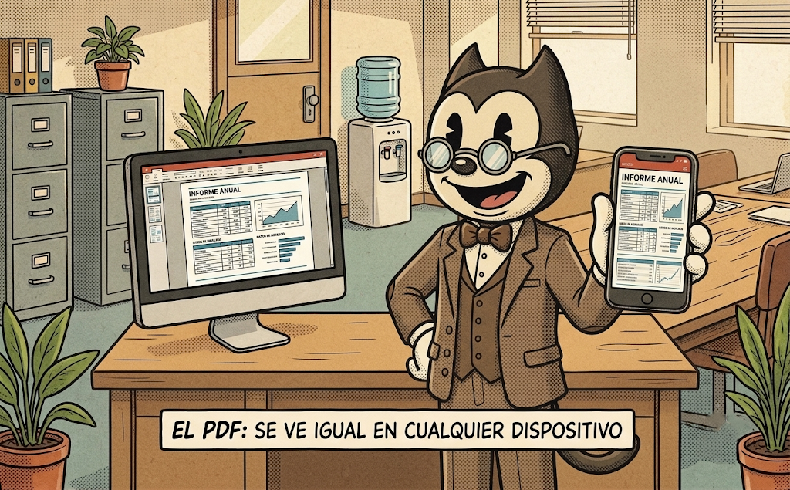
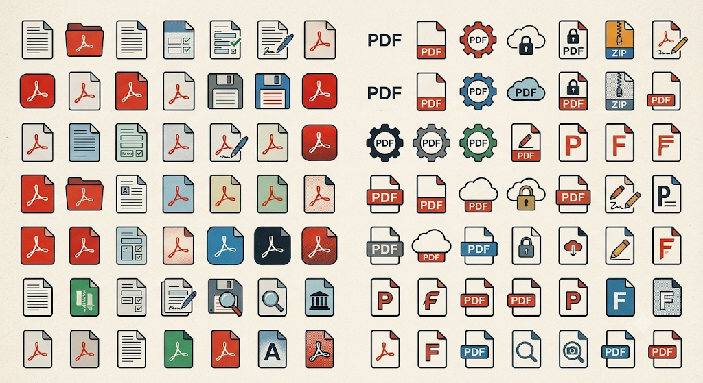
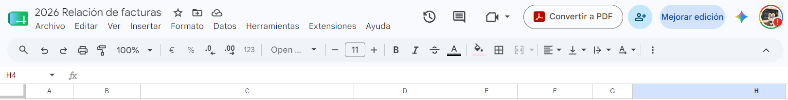
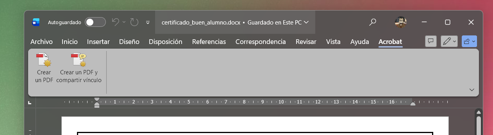
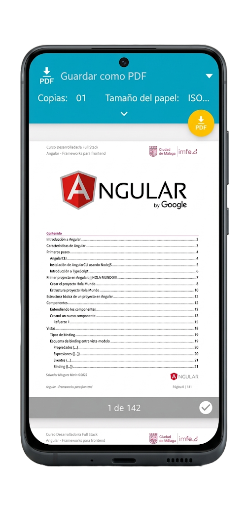
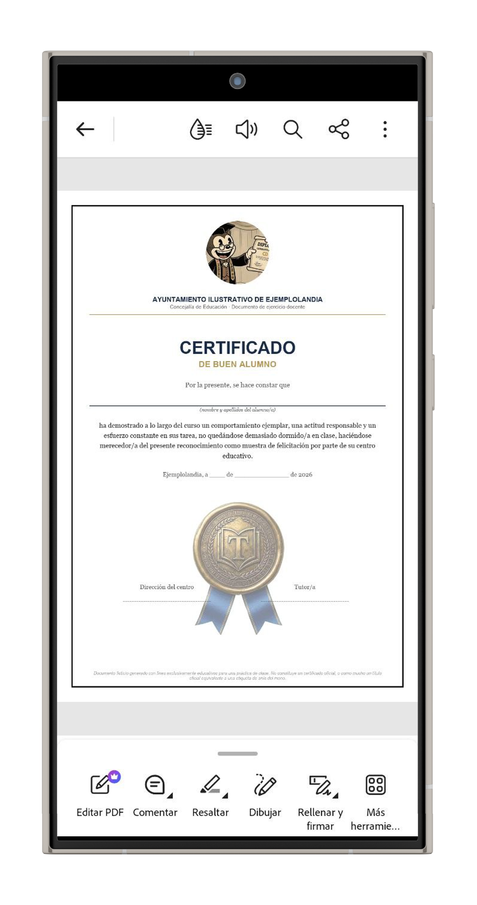
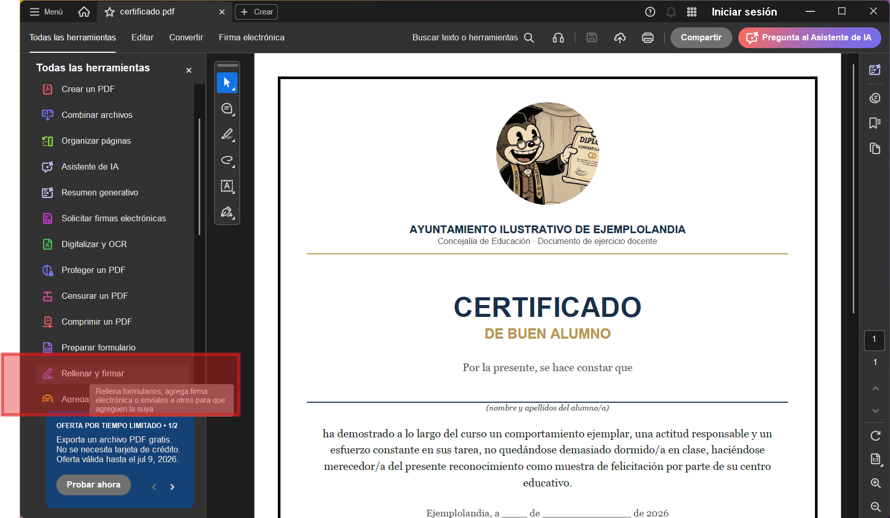
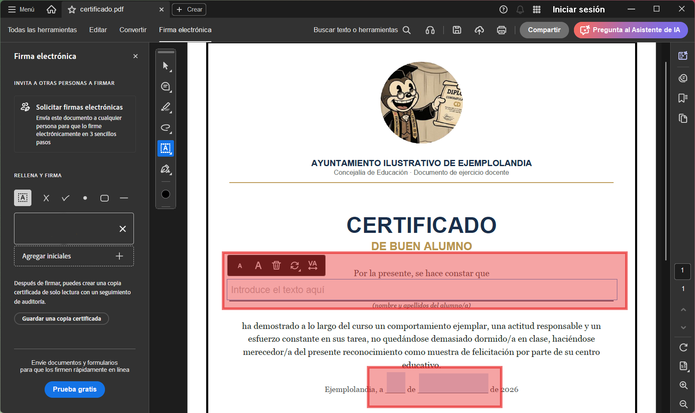

[TOC]

# 1. ¿Qué es un PDF y por qué lo usamos tanto?

{.rounded-4}

Seguro que alguna vez te han dicho: *"mándamelo en PDF"*. Y tú has pensado... ¿y eso qué es exactamente? Tranquilidad, que no es ningún bicho raro.

Un PDF es simplemente un tipo de documento, como puede serlo un Word o una foto, pero con una gracia especial: **se ve siempre igual, lo abras donde lo abras**. Si tú envías un PDF desde tu móvil, la persona que lo reciba lo va a ver exactamente igual que tú lo ves, ya sea con un iPhone, un ordenador con Windows, o un Android de hace seis años. Nada de que "se ha movido todo" o que "las letras salen raras". Por eso se usa tantísimo para documentos importantes: contratos, facturas, formularios oficiales, justificantes...

Piénsalo como una **foto de un documento, pero que se puede leer y buscar texto en ella** (a diferencia de una foto normal, donde el texto es solo un dibujo). Esa es un poco la magia del PDF.

> [!tip]
>
> Si un documento es "para guardar" o "para enviar a alguien importante" (una administración, un banco, tu trabajo...), casi siempre lo mejor es que sea PDF. Si es algo que la otra persona tiene que **poder modificar** (como un texto que estáis escribiendo entre varios), mejor mantenlo en Word, Excel o cualquier formato editable.

> [!note]
>
> No hace falta instalar nada raro para abrir un PDF. Tanto los móviles como los ordenadores actuales ya vienen preparados de fábrica para abrirlos sin problema. Eso lo veremos más adelante.

Y ya está, no hay mucho más misterio. Con esta idea en la cabeza — *"el PDF es el formato que no se descoloca nunca"* — ya tienes la base para todo lo que viene después.

# 2. Abrir y ver un PDF

Vamos con lo más básico de todo: abrir un PDF y poder leerlo tranquilamente. Aquí la buena noticia es que **no vas a tener que instalar nada** en la mayoría de los casos, porque el móvil y el ordenador ya vienen "de serie" preparados para esto.

## 📱 Desde el móvil

Cuando alguien te manda un PDF (por WhatsApp, por correo, o lo descargas de una web), normalmente solo tienes que **tocar encima del archivo**. Se abrirá automáticamente con la app que tu móvil tenga puesta por defecto para PDFs, y podrás leerlo, hacer zoom con los dedos, y moverte hacia abajo como si fuera una web.

> [!TIP]
> Si tocas el archivo y no pasa nada, o te pregunta "¿con qué aplicación quieres abrirlo?", no te agobies: elige cualquier opción que veas (suele haber alguna que ponga algo como "Archivos", "Drive" o el navegador). Cualquiera de ellas te lo va a mostrar bien.

## 💻 Desde el ordenador

Es prácticamente igual: haces **doble clic** sobre el archivo y se abre solo, normalmente con el propio navegador (Chrome, Edge, Safari...) o con una aplicación que ya viene instalada en el ordenador.

> [!NOTE]
> No necesitas comprar ni instalar ningún programa especial "para PDF". Si alguna vez ves anuncios de programas de pago para "abrir PDF", ignóralos: es una de esas cosas que el dispositivo ya sabe hacer solo.

## 🚶 Moviéndote dentro del documento

Una vez abierto, lo normal es poder:

- Deslizar hacia abajo (o hacia los lados) para pasar de página.
- Pellizcar la pantalla con dos dedos para hacer zoom (en el móvil).
- Usar la rueda del ratón o las teclas de flecha (en el ordenador).

> [!TIP]
> Si el texto se ve muy pequeño, no te fuerces la vista: haz zoom. Es gratis y no compromete.

# 3. Convertir un documento a PDF

Muchas veces no partimos ya de un PDF, sino de otra cosa: un documento de Word, una foto que le hemos hecho a un papel, o incluso una imagen cualquiera. Vamos a ver cómo convertir todo eso a PDF, que es más fácil de lo que parece.

## De Word (u otro documento) a PDF

Si tienes un documento hecho en Word (o similar), casi todas estas apps tienen una opción para "guardarlo como PDF" sin tener que hacer nada más raro.

### 📱 Desde el móvil

Dentro de la app donde tengas el documento (por ejemplo Word o Google Docs), busca la opción de **compartir** o **exportar** (suele ser un icono con una flechita hacia arriba, o tres puntos `⋮` que abren un menú). Ahí, entre las opciones, aparecerá algo como **"Guardar como PDF"** o **"Exportar a PDF"**.

> [!TIP]
> Si no encuentras la palabra "PDF" a la primera, busca en los menús que digan "Compartir", "Exportar" o "Guardar como". El PDF casi siempre se esconde ahí dentro.

### 💻 Desde el ordenador

Es muy parecido: dentro del documento, busca **Archivo > Guardar como** (o **Exportar**), y cuando te pregunte el tipo de archivo, elige **PDF** en la lista.

{.rounded-4}

{.rounded-4}

> [!NOTE]
> Esto funciona igual tanto si usas Word, como Google Docs, como muchos otros programas de escribir textos. Casi todos "saben" convertir a PDF de fábrica.

## De papel a PDF (escanear)

Esto es muy típico: tienes un papel en la mano (un contrato, un justificante, un documento del médico...) y necesitas mandarlo en PDF. Aquí lo más cómodo es usar el móvil.

Muchas apps de cámara o de archivos ya traen una función que se suele llamar **"Escanear documento"**. Lo que hace es sacarle una foto al papel, pero recortando bordes y enderezando el texto, como si fuera un escáner de verdad. Al terminar, te deja guardarlo directamente como PDF.

> [!TIP]
> Busca esta opción en tu app de **Notas**, **Cámara**, **Archivos**, o en el propio buscador del móvil escribiendo "escanear". Casi todos los móviles modernos la traen ya incorporada, sin instalar nada.

> [!NOTE]
> Si tu móvil no tiene esta opción a mano, no pasa nada: siempre puedes hacer la foto normal y luego “imprimirla”, como vemos en el siguiente apartado.

> [!important] Adobe Scan
>
> Si tu móvil no trae la función de escanear, o simplemente prefieres una app hecha para esto, **Adobe Scan** es de las más usadas y es gratuita. Solo apuntas con la cámara al papel, ella sola detecta los bordes, y te lo deja convertido en PDF en un momento. 
>
> - 📱 **Android**: [Adobe Scan en Google Play](https://play.google.com/store/apps/details?id=com.adobe.scan.android)  
> - 🍎 **iPhone**: [Adobe Scan en App Store](https://apps.apple.com/es/app/adobe-scan-esc%C3%A1ner-pdf-y-ocr/id1199564834) 
>
> **No hace falta pagar nada para lo básico: escanear y guardar como PDF es gratis.** 
> Si en algún momento te pide "suscribirte" para algo más avanzado, puedes cerrar ese mensaje tranquilamente y seguir usando la app igual.

## El truco definitivo: convertir usando "Imprimir"

Casi cualquier cosa que puedas ver en pantalla (una imagen, una página web, un documento...) tiene, escondida, la opción de **imprimir**. Y aquí viene el truco: aunque no tengas ninguna impresora conectada, dentro de esa opción de imprimir casi siempre aparece una alternativa que dice algo como **"Guardar como PDF"** o **"Imprimir a PDF"**.

Es decir, en vez de mandarlo a una impresora de verdad, el documento se guarda como PDF, tal cual se vería impreso en papel. Es una de las formas más socorridas de convertir a PDF prácticamente cualquier cosa, aunque no tenga un botón directo de "convertir".

> [!TIP]
> Búscalo así: abre lo que quieras convertir, pulsa la opción de **Imprimir** (o el icono de una impresora 🖨️), y fíjate en el desplegable donde normalmente eliges la impresora. Ahí, entre las impresoras, suele aparecer una opción que pone "Guardar como PDF".

# 4. Unir varios PDF en uno solo

A veces no necesitas un PDF suelto, sino **varios documentos juntos en uno solo**: por ejemplo, tu DNI por las dos caras, más un justificante, más una foto... y en vez de mandar cuatro archivos sueltos, mandas uno solo bien ordenado. A esto se le llama "unir" o "combinar" PDF, y es más sencillo de lo que suena.

> [!CAUTION]
> Si el documento contiene información de la empresa (contratos, datos de clientes, facturas internas...), **no lo subas a páginas web externas** para unirlo, aunque parezcan de confianza. No podemos garantizar qué pasa con esos datos una vez salen de nuestros dispositivos. Para documentación de la empresa, consulta siempre qué herramienta está autorizada a usarse.

## 📱 Desde el móvil

Aquí lo más cómodo es apoyarse en una app gratuita hecha para esto. Hay varias opciones (Adobe Acrobat, [iLovePDF](https://play.google.com/store/apps/details?id=com.ilovepdf.www), entre otras), y todas funcionan de forma parecida:

1. Abre la app y busca la opción que diga algo como **"Unir PDF"** o **"Combinar archivos"**.
2. Selecciona los documentos que quieres juntar (puedes elegirlos en el orden que quieras).
3. Confirma, y la app te genera un único PDF con todos los documentos seguidos.
4. Guarda ese nuevo archivo donde prefieras (o compártelo directamente).

> [!TIP]
> Si te piden elegir el orden de los archivos, piensa en cómo quieres que los vea la otra persona: por ejemplo, primero el DNI, después el justificante. El orden en que los coloques es el orden en que aparecerán las páginas.

> [!warning]
> Puede que la app te pida crear una cuenta gratuita o te ofrezca una versión de pago con "más funciones". Para lo básico (unir un par de PDF de vez en cuando), la versión gratuita es más que suficiente.

## 💻 Desde el ordenador

En el ordenador puedes usar esas mismas apps desde su página web, sin instalar nada: buscas "unir PDF" en el buscador, entras en una web de confianza (como [iLovePDF](https://www.ilovepdf.com/es)), subes los archivos, los ordenas y descargas el resultado.

> [!TIP]
> Estas páginas web funcionan igual de bien desde el móvil si no quieres instalar ninguna app: solo necesitas abrir el navegador (Chrome, Safari...) y buscar la web.

> [!caution]
> Al subir tus documentos a una página web, estos pasan por internet. Para papeles con datos importantes (DNI, contratos...), mejor usar páginas conocidas y evitar hacerlo desde un ordenador público o una red wifi que no sea de confianza.

# 5. Rellenar un PDF

Seguro que te ha pasado: te llega un formulario en PDF (una solicitud, un cuestionario, un impreso oficial...) y la primera tentación es imprimirlo, rellenarlo a mano y volver a escanearlo. Pero esto se puede hacer directamente desde el móvil o el ordenador, sin gastar ni un papel.

## 📱 Desde el móvil

Al abrir el PDF con la app que ya tengas instalada (la misma con la que lo ves normalmente), fíjate si aparece algún icono parecido a un **lápiz** o a una **A con un cursor** ✍️. Esa suele ser la opción para **rellenar y firmar**, o simplemente "Rellenar formulario".

> Captura de la aplicación Adobe Reader para móviles, que muestra el botón de “Rellenar y firmar”.

Al pulsarla, la app detecta automáticamente los huecos del formulario (donde hay que poner el nombre, la fecha, etc.) y te deja tocar encima para escribir. Es tan sencillo como tocar el hueco y teclear.

> [!note]
> Si el PDF tiene huecos "de verdad" (formulario interactivo), al tocarlos verás que el texto se coloca solo, bien alineado. Si no detecta ningún hueco, no pasa nada: siempre puedes añadir un cuadro de texto tú mismo y colocarlo encima, como si fuera una pegatina.

> [!tip]
>
> Desde un ordenador siempre tendrás más precisión para rellenar un PDF que desde la pantalla de un móvil. Para temas serios y delicados, usar preferiblemente un ordenador.

## 💻 Desde el ordenador

El proceso es el mismo: abres el PDF con el programa que uses habitualmente (el navegador también suele valer), buscas la opción de **"Rellenar y firmar"** (normalmente en la barra de herramientas de arriba), y vas tocando con el ratón en cada hueco para escribir.

{.rounded-3}

{.rounded-3}

> [!warning]
>
> En nuestro PDF, verás que la herramienta para Rellenar, ha detectado los “huecos” del formulario y tan solo tenemos que hacer clic en ellos y escribir. 

> [!important]
>
> No hace falta convertir el PDF a Word ni nada parecido para rellenarlo. De hecho, es mejor no hacerlo: al convertirlo pierde el formato, y luego hay que volver a pasarlo a PDF. Rellénalo directamente sobre el propio PDF.

> [!CAUTION]
>
> Es muy normal que estas apps te muestren carteles de "oferta", "prueba premium" o "hazte suscriptor" en cuanto las abres. Ignóralos tranquilamente: las opciones básicas (como rellenar un formulario) son siempre gratuitas y no necesitas suscribirte a nada para hacer lo que estamos viendo aquí. No dejes que te engañen con esos avisos.

## 💾 Guardar los cambios

Un último paso importante: una vez que has terminado de rellenar o firmar, **tienes que guardar los cambios**, o se perderán al cerrar la app.

Busca un botón que diga **"Guardar"**, **"Guardar como"**, o que tenga el símbolo de un disquete 💾 (normalmente arriba a la derecha, o dentro del menú de opciones). Al pulsarlo, puede que te pregunte si quieres guardar los cambios sobre el mismo archivo, o crear uno nuevo.

> [!CAUTION]
> Lo más importante de todo: **fíjate bien en dónde se guarda el documento** (qué carpeta, o con qué nombre). Es el fallo más típico: se rellena y se firma todo perfecto, pero luego no hay quien encuentre el archivo para poder enviarlo. Si no sabes dónde ha quedado guardado, no vas a poder adjuntarlo después por correo, WhatsApp o donde lo necesites.

> [!TIP]
> Si no estás seguro de dónde se guarda, elige siempre la opción **"Guardar como"**: normalmente te deja ver y elegir tú mismo la carpeta de destino, en vez de guardarlo sin más en un sitio que no controlas.

## Cuando el formulario no tiene huecos "de verdad"

A veces el PDF es, en realidad, más parecido a una foto o un escaneo: no tiene huecos que se puedan tocar, sino que hay que "escribir encima" a mano alzada, como si dibujaras. En ese caso, busca la opción de **añadir texto** o **cuadro de texto** dentro de las herramientas de edición, haz clic donde quieras escribir, y ya tienes una cajita de texto que puedes mover y ajustar donde haga falta.

> [!TIP]
> Después de rellenarlo, échale un vistazo completo antes de enviarlo: es fácil que algún hueco se quede sin rellenar o que el texto se salga un poco de su sitio.

# 6. Firmar un PDF

Y llegamos a la última herramienta básica: **firmar un PDF**. Aquí no vamos a hablar de firmas digitales con certificados raros ni nada complicado, sino de la firma "de andar por casa": dibujar tu firma en la pantalla y colocarla sobre el documento, tal cual harías con un bolígrafo sobre un papel.

	<video src="img/07-documentacion/firmar.mp4" autoplay muted loop playsinline controls></video>    

> En el vídeo se puede ver como usamos la opción de **Rellenar y firmar**  para añadir una firma en letra, posteriormente pulsamos el icono de la pluma ✒️para cambiar a firmar con el dedo. Y ajustamos la firma manual al tamaño y posición que queramos.

## 📱 Desde el móvil

Dentro de la misma opción que usamos para rellenar (**"Rellenar y firmar"**), suele haber un icono aparte, normalmente con forma de firma o de una pluma ✍️. Al tocarlo, te aparecen varias formas de firmar:

1. **Dibujar la firma** con el dedo, directamente sobre la pantalla.
2. **Escribirla con el teclado**, y la app la convierte en una letra tipo "manuscrita".
3. Usar una firma que hayas guardado antes, para no tener que repetirla cada vez.

Una vez la tengas, solo tienes que **colocarla donde corresponda** en el documento (tocando y arrastrando hasta el sitio) y ajustar el tamaño si hace falta.

> [!TIP]
> Si vas a firmar documentos con cierta frecuencia, guarda tu firma la primera vez que la hagas. Así, las próximas veces, solo tendrás que seleccionarla y colocarla, sin dibujarla de nuevo.

## 💻 Desde el ordenador

El proceso es igual de sencillo: dentro de la opción de "Rellenar y firmar", eliges crear una firma. Si el ordenador tiene pantalla táctil, puedes dibujarla con el dedo o el lápiz; si no, lo más cómodo es escribirla con el teclado y dejar que el programa la convierta en un estilo manuscrito, o dibujarla con el ratón (aunque queda menos bonita).

> [!TIP]
> Si quieres una firma con mejor pinta, puedes firmar en un papel en blanco, hacerle una foto, y usarla como imagen de firma. Muchas apps te dejan subir una foto y ellas solas "limpian" el fondo para que parezca una firma normal.

## 💾 Guardar los cambios

Como ya vimos al rellenar el PDF, no olvides **guardar los cambios** al terminar de firmar (botón "Guardar" o el disquete 💾), y fíjate bien en dónde queda guardado el archivo para poder encontrarlo después.

> [!TIP]
> Si tienes dudas sobre cómo guardar bien o dónde queda el archivo, repasa el apartado "Guardar el documento" del punto 5.

## ¿Y esto vale como firma "de verdad"?

Para la mayoría del día a día (autorizaciones internas, formularios sencillos, documentos entre compañeros...), esta firma dibujada es más que suficiente. Pero para trámites oficiales muy concretos (con la Administración, notarías, según qué contratos...) puede que se exija una **firma digital certificada**, que es otra cosa distinta y que no vamos a ver en este manual.

> [!NOTE]
> Ante la duda de si un documento necesita firma digital certificada o basta con la firma dibujada, es mejor preguntar antes a quien te haya pedido el documento.

> [!CAUTION]
> Ten cuidado con dónde guardas o compartes tu firma dibujada (o la foto de tu firma en papel). Aunque no sea una firma "oficial", es una imagen que te identifica, así que no la mandes a cualquier sitio ni la subas a páginas que no sean de confianza.

# 7. Resumen y trucos finales

Ya hemos visto todo lo básico para manejarte con PDF en el día a día. Aquí tienes un chuletario rápido para repasar de un vistazo, sin tener que releer todo el manual entero.

## Chuleta rápida

| Quiero...                      | Dónde buscarlo                               |
| ------------------------------ | -------------------------------------------- |
| Abrir un PDF                   | Tocar/hacer doble clic sobre el archivo      |
| Convertir Word a PDF           | Compartir/Exportar > Guardar como PDF        |
| Convertir un papel a PDF       | App de escanear (o Adobe Scan)               |
| Convertir cualquier cosa a PDF | Imprimir > Guardar como PDF                  |
| Unir varios PDF en uno         | App tipo Adobe Acrobat / iLovePDF > Unir PDF |
| Rellenar un formulario         | Icono de "Rellenar y firmar"                 |
| Firmar un documento            | Icono de firma dentro de "Rellenar y firmar" |

> [!TIP]
> Si no recuerdas dónde está una opción, prueba siempre primero a buscar el icono de **Compartir** <kbd><i class="pi pi-share-alt"></i></kbd> o el menú de **tres puntos** <kbd><i class="pi pi-ellipsis-v"></i></kbd>. 
> El 90% de las funciones de este manual se esconden ahí dentro.

## Las tres ideas para llevarte a casa

1. **El PDF no se descoloca nunca.** Por eso se usa para todo lo importante: se ve igual en cualquier dispositivo.
2. **No hace falta instalar programas de pago.** El móvil y el ordenador ya saben hacer casi todo esto de fábrica, y las apps que necesitas de más son gratuitas para lo básico.
3. **Cuidado con los datos de la empresa.** Si el documento tiene información sensible, mejor no subirlo a páginas web externas para tratarlo.

